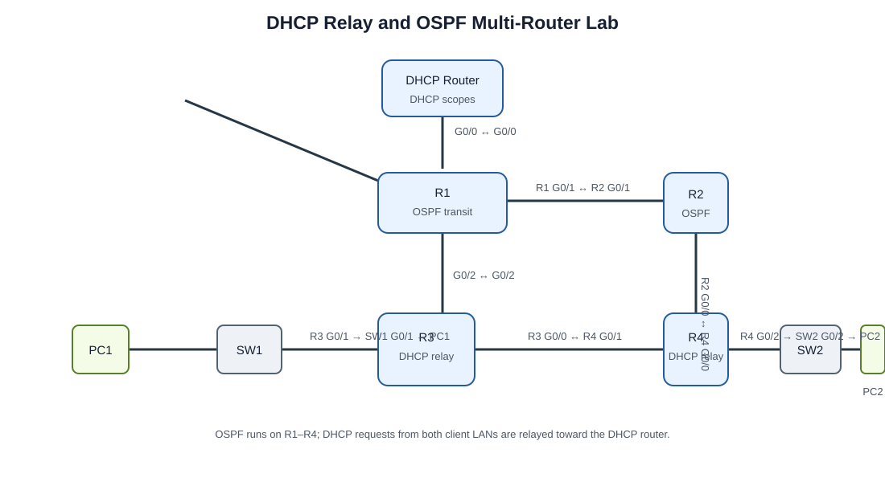

# DHCP Relay and OSPF Multi-Router Lab

A Cisco Packet Tracer lab combining centralized DHCP with dynamic OSPF routing across four routers. Two client LANs sit behind edge routers, while a separate router provides DHCP services across the routed network.

## Lab goals

- Configure OSPF across a four-router network and establish neighbor relationships.
- Configure loopback interfaces and use stable OSPF router IDs.
- Provide DHCP addressing from a centralized DHCP router.
- Relay client DHCP broadcasts from remote LANs with `ip helper-address`.
- Verify learned routes and end-to-end reachability between the two client LANs.
- Troubleshoot interface, OSPF, DHCP pool, and relay issues using IOS show commands.

## Topology



The lab uses five routers total: a dedicated DHCP router plus R1–R4. R1–R4 form the OSPF domain. PC1 and PC2 are on separate switched LANs behind R3 and R4.

### Link and interface map

| Connection | Interface at endpoint A | Interface at endpoint B |
|---|---|---|
| DHCP router ↔ R1 | DHCP router `G0/0` | R1 `G0/0` |
| R1 ↔ R2 | R1 `G0/1` | R2 `G0/1` |
| R1 ↔ R3 | R1 `G0/2` | R3 `G0/2` |
| R2 ↔ R4 | R2 `G0/0` | R4 `G0/0` |
| R3 ↔ R4 | R3 `G0/0` | R4 `G0/1` |
| R3 ↔ SW1 | R3 `G0/1` | SW1 `G0/1` |
| SW1 ↔ PC1 | SW1 `Fa0/1` | PC1 `Fa0` |
| R4 ↔ SW2 | R4 `G0/2` | SW2 `G0/2` |
| SW2 ↔ PC2 | SW2 `Fa0/1` | PC2 `Fa0` |

## DHCP relay design

PC1 and PC2 send DHCP requests as local broadcasts. Their default gateways, R3 and R4, relay those requests toward the DHCP router using `ip helper-address`. The DHCP router needs a scope for each client LAN, including the correct subnet mask and default gateway. OSPF provides reachability among R1–R4; the DHCP router also needs a return route to the client LANs, through an appropriate routing configuration or static routes.

## Verification checklist

Run these commands on the routers as appropriate:

```text
show ip interface brief
show ip ospf neighbor
show ip ospf interface brief
show ip route
show ip route ospf
show running-config | section router ospf
show running-config | include helper-address
show ip dhcp pool
show ip dhcp binding
```

Then verify from the clients:

1. Confirm each PC receives an address, mask, and default gateway from DHCP.
2. Ping its default gateway.
3. Ping the remote client across the OSPF network.
4. If DHCP fails, check the helper address, DHCP pool network and gateway, interface state, and the DHCP router's return route.
5. If routing fails, confirm OSPF neighbors reach `FULL`, router IDs are unique, and all required networks are advertised.

## Platform

- Cisco Packet Tracer
- Cisco IOS router and switch CLI
- OSPF
- DHCP pools and DHCP relay

## Addressing and device configurations

The topology screenshot does not contain the lab's IP allocations or CLI output. Those values are intentionally omitted rather than guessed. Add the verified addressing table, router configurations, and the `.pkt` file alongside this README when exported from the completed Packet Tracer lab.
