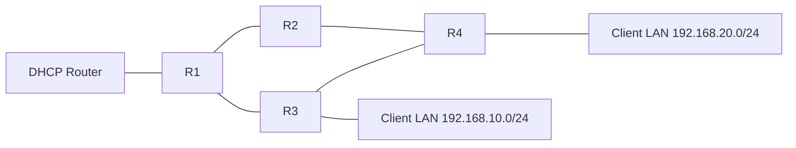

# DHCP and OSPF Route Failover Lab

A Cisco Packet Tracer lab with centralized DHCP, DHCP relay, and OSPF. This exercise adds OSPF path preference and link failover between R4 and the DHCP-side network.

## Topology



The two candidate paths from R4 toward the DHCP router are:

- Preferred: R4 → R2 → R1 → DHCP Router
- Backup: R4 → R3 → R1 → DHCP Router

The transit networks use /30 subnets: DHCP Router–R1 `10.0.0.0/30`, R1–R2 `10.0.0.4/30`, R1–R3 `10.0.0.8/30`, R2–R4 `10.0.0.12/30`, and R3–R4 `10.0.0.16/30`.

## Configure path preference

R4 G0/1 connects to R3. Raising its OSPF cost makes the path through R3 less attractive when R4 calculates routes toward the DHCP network.

```text
R4(config)# interface g0/1
R4(config-if)# ip ospf cost 10
```

Check the route on R4:

```text
R4# show ip route 10.0.0.0
O 10.0.0.0/30 [110/3] via 10.0.0.13, GigabitEthernet0/0
```

The `O` marks an OSPF route. In `[110/3]`, 110 is the administrative distance and 3 is the OSPF cost. The address after `via` is the next hop: `10.0.0.13`, R2 on the R4–R2 link.

## Test failover

Shut down R4's G0/0 interface toward R2:

```text
R4(config)# interface g0/0
R4(config-if)# shutdown
```

R4 should reconverge through R3. The observed route was:

```text
O 10.0.0.0/30 [110/12] via 10.0.0.17, GigabitEthernet0/1
```

Here, `10.0.0.17` is R3's address on the R3–R4 link. The increased metric reflects the higher-cost backup path.

Restore the R2 link:

```text
R4(config-if)# no shutdown
```

After the link returned, OSPF selected the lower-cost path through R2 again.

## What this demonstrates

- OSPF interface cost can influence route preference.
- OSPF recalculates routes when a link fails and can use an alternate path.
- `via` in the routing table identifies the next-hop router.
- SPF is calculated independently by each router. The route back toward R4 can follow a different path, so inspect the route on the router forwarding return traffic.

## Lab file

Open [dhcp-ospf-route-failover.pkt](dhcp-ospf-route-failover.pkt) with Cisco Packet Tracer.

This is a simulated learning lab, not a production network.
