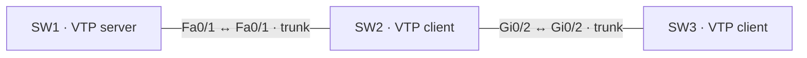

# VTP v2 Three-Switch Lab

A hands-on Cisco Packet Tracer lab for configuring VTP version 2, propagating VLANs from a server to clients, and troubleshooting domain and password mismatches.

> The switch configurations and troubleshooting sequence are based on a working three-switch lab. Packet Tracer device models may use different interface names. No `.pkt` file is included; build the topology using the port map below.

## Lab goals

- Configure one VTP server and two VTP clients in the same domain.
- Carry VTP advertisements over operational switch trunks.
- Create VLANs once on the server and verify client propagation.
- Compare VTP configuration revisions to confirm synchronization.
- Troubleshoot domain and password mismatches using observed symptoms.
- Explain why a client cannot originate VLAN changes.

## Topology



| Link | Switch ports | Purpose |
|---|---|---|
| SW1 ↔ SW2 | SW1 Fa0/1 ↔ SW2 Fa0/1 | VTP and VLAN traffic |
| SW2 ↔ SW3 | SW2 Gi0/2 ↔ SW3 Gi0/2 | VTP and VLAN traffic |

The links must be operational trunks. If your Packet Tracer switch uses different interfaces, substitute the correct port names at both ends.

## VLAN database

These VLANs were created on SW1 and learned by the clients through VTP:

| VLAN ID | Name |
|---:|---|
| 10 | Sales |
| 20 | IT |
| 30 | Engineering |
| 40 | HR |
| 50 | Finance |
| 60 | Maintence |
| 80 | Staff |
| 999 | Native-Vlan |

VLAN 50 was added during the domain-mismatch test; VLANs 60 and 80 were added during the password test. VTP distributes VLAN definitions. It does not automatically assign endpoint ports or set the native VLAN on a trunk.

## Configure VTP

Use the same domain and password on all three switches. Configure VTP version 2 while each switch is in server mode, then set the intended modes. On common Cisco IOS VTP v1/v2 platforms, the version setting is only configurable in server or transparent mode.

Replace `<LAB_PASSWORD>` with a password used only for this isolated lab. Do not publish a real or reused password.

### SW1 — server

```ios
enable
configure terminal
hostname SW1
vtp domain CAMPUS-LAB
vtp version 2
vtp password <LAB_PASSWORD>
vtp mode server
end
```

### SW2 and SW3 — clients

On each client, first configure domain, version, and password while it is in server mode. Then change its mode to client. If you already changed a switch to client before setting the version, temporarily return it to server mode, set version 2, and set it back to client.

```ios
enable
configure terminal
hostname SW2
vtp domain CAMPUS-LAB
vtp version 2
vtp password <LAB_PASSWORD>
vtp mode client
end
```

Use `hostname SW3` on the third switch.

## Configure the trunks

Configure both ends of both inter-switch links:

```ios
! SW1
configure terminal
interface fastethernet0/1
 description TRUNK_TO_SW2
 switchport mode trunk
 no shutdown
end

! SW2
configure terminal
interface fastethernet0/1
 description TRUNK_TO_SW1
 switchport mode trunk
 no shutdown
interface gigabitethernet0/2
 description TRUNK_TO_SW3
 switchport mode trunk
 no shutdown
end

! SW3
configure terminal
interface gigabitethernet0/2
 description TRUNK_TO_SW2
 switchport mode trunk
 no shutdown
end
```

Catalyst 2960 switches use 802.1Q and do not need an encapsulation command. Other models may require `switchport trunk encapsulation dot1q` before `switchport mode trunk`.

## Create VLANs on the server

Create and name VLANs on SW1 only:

```ios
configure terminal
vlan 10
 name Sales
vlan 20
 name IT
vlan 30
 name Engineering
vlan 40
 name HR
vlan 50
 name Finance
vlan 60
 name Maintence
vlan 80
 name Staff
vlan 999
 name Native-Vlan
end
```

The spelling `Maintence` reflects the VLAN name in the lab's observed output. VTPv2 supports normal-range VLAN IDs; the VLANs in this lab are within that range.

## Verify propagation

Run these commands on all three switches:

```ios
show vtp status
show vtp counters
show vlan brief
show interfaces trunk
```

Check that:

- SW1 reports server mode; SW2 and SW3 report client mode.
- All switches show the `CAMPUS-LAB` domain and VTP version 2.
- VLANs 10, 20, 30, 40, 50, 60, 80, and 999 appear with matching names.
- Configuration revision numbers match after the switches synchronize.
- The listed inter-switch links are operational trunks.

## Troubleshooting exercises and observed results

### Domain mismatch

1. Change SW3's domain to `CAMPUS-TEST`.
2. Create VLAN 50 (`Finance`) on SW1.
3. Observe that SW2 learns the VLAN while SW3 does not.
4. Restore SW3 to `CAMPUS-LAB`; SW3 then learns VLAN 50 and synchronizes.

**Root cause:** SW3 was not in the server's VTP domain, so it did not accept the domain's updates.

### Password mismatch

1. Change only SW3's VTP password.
2. Create another test VLAN on SW1.
3. Observe that SW3 does not learn the update while SW2 does.
4. Restore the matching password; SW3 then accepts the update and revisions synchronize.

**Root cause:** The VTP password did not match, so SW3 rejected the advertisement.

### Client mode

Try to create a VLAN from SW2 while it is in client mode. The switch rejects the change. Create VLANs on the server and let clients learn them.

### Trunk fault (optional)

Temporarily change SW2's link to SW3 to access mode, then inspect `show interfaces trunk`. Restore trunk mode afterward. VTP advertisements require the inter-switch connection to be trunking.

## Troubleshooting order

When a client does not show an expected VLAN, check:

1. Does a VTP server have that VLAN in `show vlan brief`?
2. Are all inter-switch links up and listed in `show interfaces trunk`?
3. Do `show vtp status` outputs show the expected domain, version, and modes?
4. If configured, does the VTP password match on every switch?
5. Is the VLAN in the normal range supported by VTP v2?
6. After the fix, do the VLAN appear and configuration revisions match?

## Revision-number safety

VTP configuration revisions increase when the VLAN database changes. A switch joining a domain with an unexpectedly high revision can cause unwanted VLAN database changes. Keep practice switches isolated, inspect `show vtp status` before connecting reused equipment, and reset only lab devices when appropriate.

## Commands quick reference

```ios
show vtp status
show vtp counters
show vlan brief
show interfaces trunk
show interfaces fastethernet0/1 switchport
show interfaces gigabitethernet0/2 switchport
```

